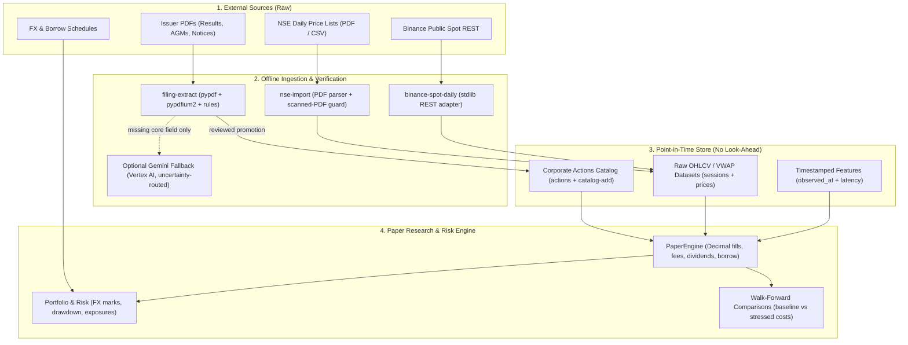

# AsOf

**AsOf** *(formerly FinGPT Trader)* is a broker-free, point-in-time market intelligence, filing evidence, and paper portfolio simulation engine. It replays market data and issuer documents strictly as they became available, preserves verbatim source citations, and simulates paper portfolios with exact `Decimal` accounting. Individual books use their listing currency, and portfolio studies combine separately funded books in one base currency. Python 3.11+ runs the core research CLI with the standard library.

## Architecture

Research ingestion, point-in-time storage, and paper simulation are strictly separated from live broker execution. Deterministic rules run first; hosted Gemini fallback is invoked only when a filing candidate misses a core field, and every claim requires a verbatim source quote.



## Try the replay

```sh
python3 main.py
python3 main.py replay --dataset nse --as-of 2025-01-08T15:00:00+03:00
python3 main.py evidence --dataset nse --as-of 2025-01-09T15:00:00+03:00
python3 main.py paper --dataset nse --policy buy_hold
python3 main.py compare --dataset nse
python3 main.py evaluate --dataset nse
```

The default replay contains 12 captured Binance BTC/USDT daily bars. The NSE example contains 13 fictional KES sessions, an issuer statement, two versions of one dividend notice, a court filing, a decision and a news report. Try the two January cutoffs above. At the January 8 close the original dividend is KES 1.00. The correction to KES 1.20 arrives after that close. The example calendar, fees, prices, liquidity and labels are teaching inputs. The bundled cases exercise the software and provide no estimate of investment performance.

## Import local data

Copy a [sample dataset](asof/fixtures/nse) and pass its directory to `--dataset`. Keep privately licensed source files locally. One manifest identifies the stable listing, issuer, currency, venue, lot size, adapter, source, capture time and calendar version. Use raw prices with separately recorded dividends and split/bonus corporate actions. A single-listing report uses its listing currency. The portfolio command translates the funded books using dated FX observations.

| File | Contents |
| --- | --- |
| `sessions.csv` | Versioned session dates and explicit timezone-aware opens and closes. Supply the applicable exchange calendar, including holidays and exceptional sessions. |
| `prices.csv` | One row per session with raw OHLCV, availability time and trading status. Suspended sessions carry an explicit valuation mark. |
| `documents.json` | Immutable document IDs, source references, issuer, attributed document kind, publication and ingestion times, and an array of page texts. Optional fields include the financial period, predecessor document ID and curated dividend terms. |
| `labels.json` | Optional field references for evaluation, including expected text, page and supporting span. Maintain these independently for a real study. |
| `klines.json` | For the Binance spot adapter, use a frozen UTC daily REST kline response with millisecond timestamps and its capture time in the manifest. |

Replay reconstructs public availability. Ingestion time separately records when the snapshot was collected. A date-only publication becomes eligible at the next listed session open. For bulk-imported history, the output describes what public evidence supports, rather than the arrival history of an actual trading feed. Extracted pages must preserve source page order. The rules extractor abstains on ambiguous matches. A filing preserves the claimant's attribution and a judgment preserves the court's attribution.

## Paper portfolios and comparisons

Paper is the only execution mode of the research CLI. The default paper policy holds cash. A producer emits a timestamped research signal with its version, horizon and evidence. Portfolio sizing converts it to a long-only target and approves a quantity. A pending quantity can fill on a later tradable raw close, capped by participation, available cash, lot size and exposure. Fee and slippage assumptions apply to each fill. The closing-price approximation is suited to daily-bar research. A dividend becomes a receivable using the holding before its ex-date and becomes cash on the first session on or after payment. Only curated corporate action terms can post to the ledger.

```sh
python3 main.py paper --dataset nse --policy price --fee-bps 15 --slippage-bps 8 --participation 0.005
python3 main.py paper --dataset /data/initial-snapshot --policy price --follow
```

In follow mode, a local publisher writes the directory of each completed snapshot to standard input, one per line. Standard output emits a JSON portfolio report for each extension. Repeated snapshots are idempotent. Publish each snapshot atomically, append corrections as new documents, and retain the snapshot sequence for recovery. A changed historical bar or backdated source requires a fresh historical replay.

The comparison reads the fixed test start, one-session horizon and fold length from the manifest. Earlier prices warm up the factor. The book carries through consecutive test folds. Cash, buy-and-hold including dividends, and one-session price momentum use the same costs and liquidity rules. A second scenario doubles fee and slippage and halves participation. Reports include drawdown, turnover, exposure, fees and net returns. The historical comparison uses long-only policies. For a borrow or cross-currency study, use the portfolio command below.

### Cross-currency and borrow studies

```sh
python3 main.py replay --dataset nse-public-sample
python3 main.py portfolio --spec examples/kes-portfolio.json
```

The public sample is a single Safaricom observation checked against the NSE price list dated September 2, 2026. Its opening price is unknown. Its VWAP can value a holding but cannot execute a paper order. The captured document gives the dividend amount and book closure. Posting a payment requires separately verified entitlement terms.

The [example study](examples/kes-portfolio.json) pre-funds two books in KES and USDT. FX is quoted as base currency per unit of listing currency. Each translation uses a rate available at the valuation time. Missing rates, stale rates and stale held-position marks stop the study. Weights must total one. Optional study fields enable periodic cross-sleeve cash rebalancing (`"rebalance": "daily" | "weekly" | "monthly"`), single-name concentration caps (`"max_single_weight"`), and passive benchmark attribution (`"benchmark"`), reporting Sharpe, Sortino, HHI concentration, per-sleeve `days_to_exit`, tracking error, information ratio, and beta.

## Cross-sectional factor research & local web workstation

Evaluate strictly point-in-time cross-sectional factors (`momentum_20d`, `momentum_60d`, `liquidity_adv20`, `dividend_yield`, `earnings_yield`) with Spearman Rank-IC, IC-IR, hit rate, and quantile spreads across a multi-ticker NSE universe:

```sh
python3 -m asof factors --universe ./local-data/universe --catalog ./local-data/catalog --horizons 1,5,20 --min-adv 100000
```

Launch the local, paper-only web workstation (pure Python stdlib, loopback-only by default) with **Filing Workbench**, **As-Of Explorer**, **Multi-Ticker Market & Liquidity Board**, and **Paper Risk Lab**:

```sh
python3 -m asof serve --port 8765
# Enable one-click catalog promotion and the multi-ticker NSE Board:
python3 -m asof serve --port 8765 --catalog ./local-data/catalog --universe ./local-data/universe
```

A short sale requires explicit dated loan inventory. A schedule sets maximum outstanding units, an annual rate, expiry and a buy-in premium. Loan fees accrue ACT/365 on the preceding mark, including weekends. A reduction in the allowed outstanding quantity or an expiry triggers a buy-in subject to tradable volume. The last known loan rate continues on overdue units. Short holders owe any eligible dividend. For a single book pass `paper --policy short_hold --borrow loan.json`, with `instrument` and a `records` array using the example's borrow fields. The included FX and borrowing terms are synthetic scenario assumptions.

## Historical dividend research

Query dated issuer disclosures with `python3 -m asof actions --as-of 2026-06-30 --status approved`. Add `--symbol EQTY --history` to inspect a single issuer over time. The offline catalog covers nine Kenyan issuers. Each field retains its supporting source, and inference runs separately. [Disclosure clocks, corpus and model comparisons](docs/dividend-catalog.md)

## Optional model experiments

Supply a hosted Gemini project (`--vertex-project`) or a locally merged GGUF (`--gguf`, install `.[model]`) for optional model experiments. The evaluator compares models against the deterministic parser with field accuracy, citation precision, abstentions, elapsed time and token counts.

```sh
python3 main.py evaluate --dataset nse --gguf /models/fingpt.gguf --structured
python3 main.py evaluate --corpus asof/fixtures/issuer-excerpts --gguf /models/fingpt.gguf --structured
python3 main.py features --dataset nse --gguf /models/fingpt.gguf --structured --model-available-at 2024-12-01T00:00:00Z --latency-seconds 60 > features.json
python3 main.py compare --dataset nse --features features.json
```

Use the actual model availability date and a defensible inference delay in an experiment. The example arguments illustrate the format. The additional policy applies the same price factor with a sentiment filter on its first eligible observation. Treat generated sentiment as a hypothesis. Assess its incremental value on a separately frozen, reviewed sample before drawing conclusions.

[Local model evaluation and provider design](docs/research-validation.md)

## Full-filing PDF extraction and NSE price lists

Extract cited dividend events directly from complete issuer PDFs, promote reviewed outputs into a local corporate-actions catalog, and import standard NSE Daily Equity Price List PDFs or CSVs into `nse-daily` datasets:

```sh
python3 -m pip install -e '.[filings]'
python3 -m asof filing-extract --pdf scbk-fy24.pdf --symbol SCBK --source "$ISSUER_URL" > scbk.json
python3 -m asof financials-extract --pdf scbk-fy24.pdf --symbol SCBK --source "$ISSUER_URL"
python3 -m asof filing-extract --pdf scbk-fy24.pdf --symbol SCBK --source "$ISSUER_URL" --vertex-project YOUR_PROJECT
python3 -m asof catalog-add --report scbk.json --notice-date 2025-03-19 --catalog ./my-catalog
python3 -m asof actions --as-of 2025-03-20 --symbol SCBK --catalog ./my-catalog
python3 -m asof nse-import --input ./nse-daily-lists --symbol SCOM --out ./datasets/scom
python3 -m asof replay --dataset ./datasets/scom
```

Deterministic rules run first. When `--vertex-project` (hosted Gemini) or `--gguf` is supplied, the model is invoked only as a fallback for candidates missing a core field. See [Full-filing PDF extraction and NSE price lists](docs/full-filing-ingestion.md) and [Working with real NSE data](docs/real-nse-data.md) for bulk `--universe` CSV import, persisted `financials --as-of` catalogs, and scanned-PDF handling.

## Development

```sh
python3 -m pip install -e '.[dev,filings]'
python3 -m pytest -q tests
```

New read-only adapters can be supplied to `load_dataset(..., adapters={...})`. Custom signal producers can be passed to `PaperEngine` and receive the listing, current bar, previous tradable bar and available features. The legacy async crypto bot was archived at git tag `v0.1-legacy-crypto`.

## License

Apache License 2.0 — see [LICENSE.md](LICENSE.md) and [NOTICE](NOTICE) for details.

## Acknowledgements

This project builds on the foundation of several open-source projects and research:

- **FinGPT Research**: Financial NLP concepts inspired by the [FinGPT paper](https://arxiv.org/abs/2306.06031).
- **pypdf & pypdfium2**: Offline layout text extraction and dual-decoder PDF coverage verification.
- **llama.cpp & Vertex AI**: Optional local GGUF and hosted Gemini structured-output backends.
- **Binance Public Spot REST API**: Secondary crypto market data adapter demonstrating asset-agnostic replay.

## Contributing

Contributions are welcome! Please fork the repository and submit a pull request with your changes. Ensure to follow the code style and include tests for new features. See [CONTRIBUTING.md](CONTRIBUTING.md) for more details.
